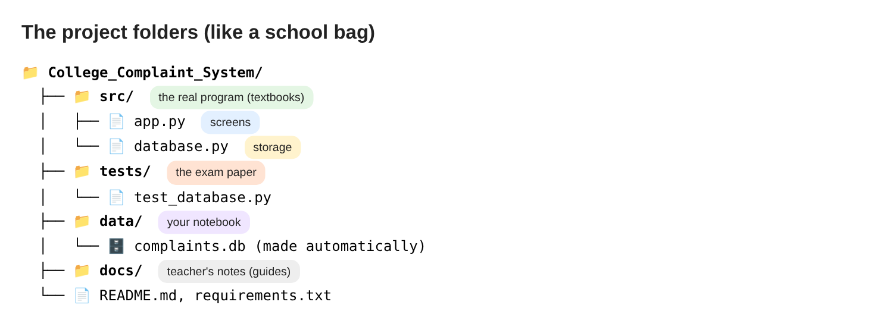
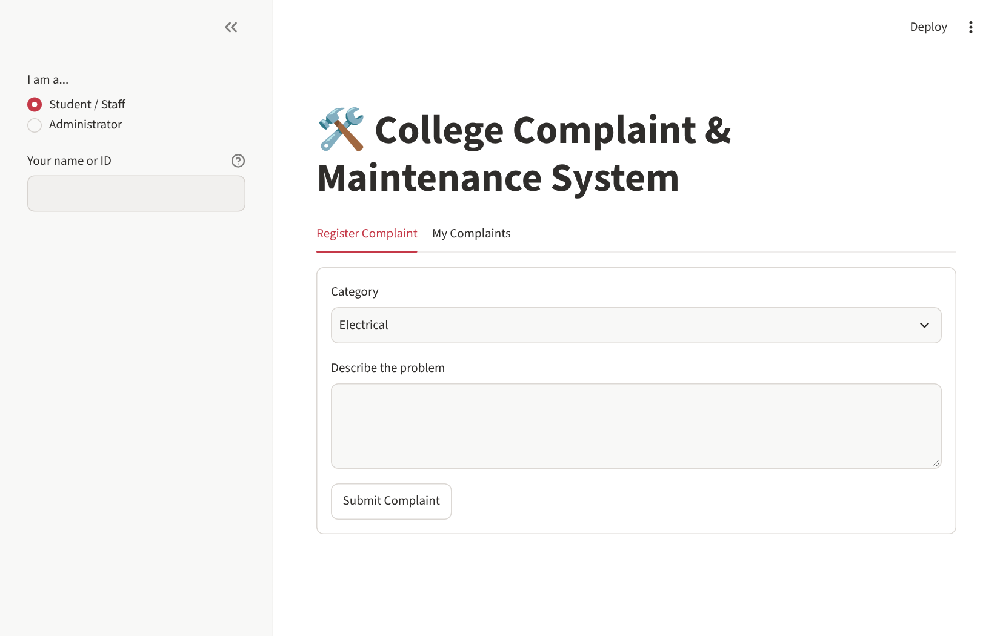
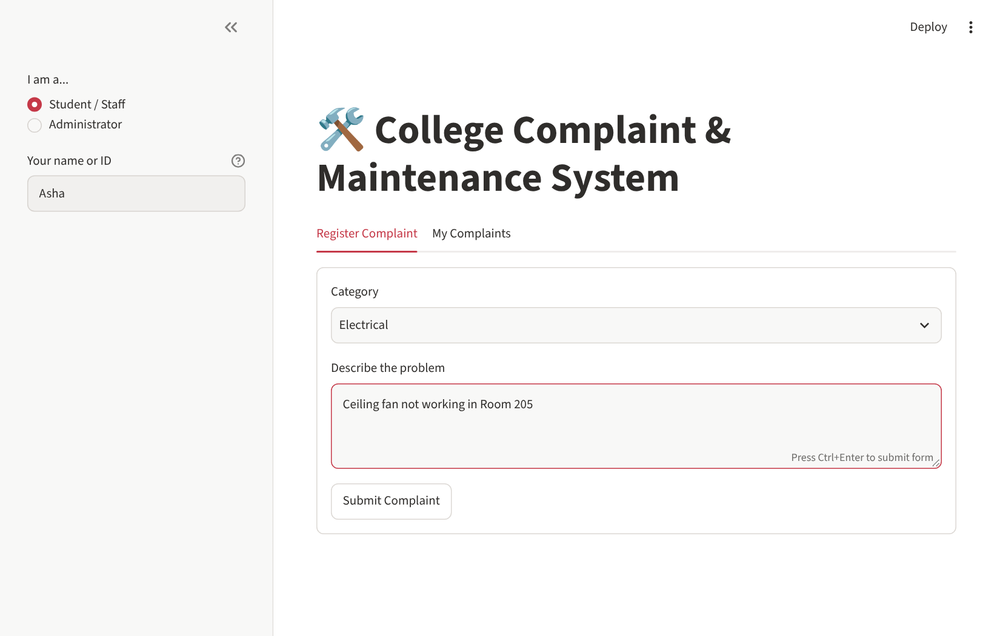
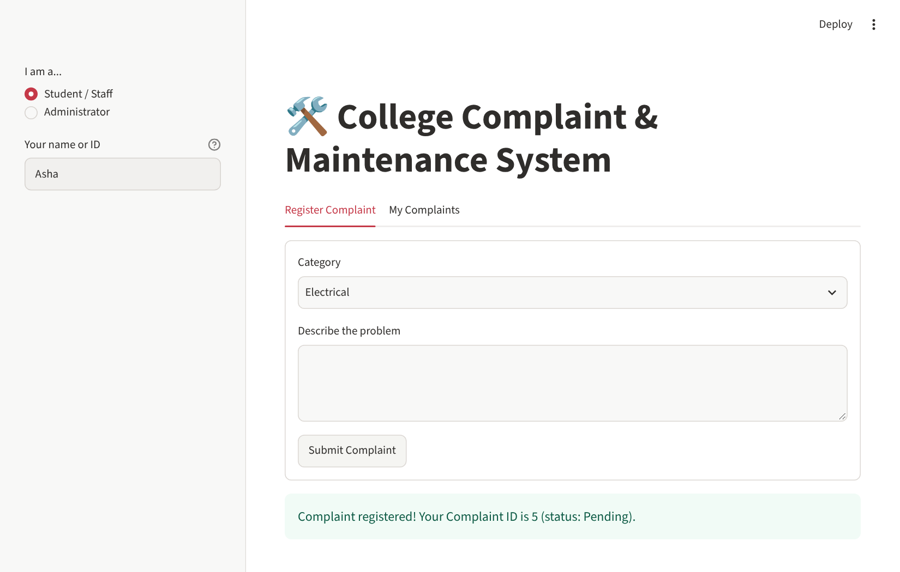
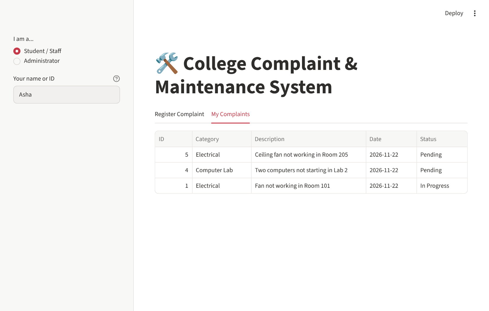
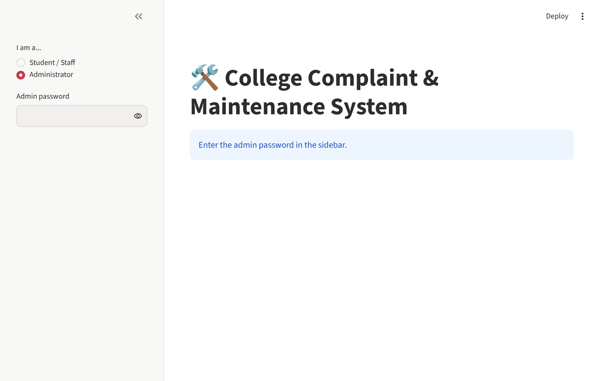
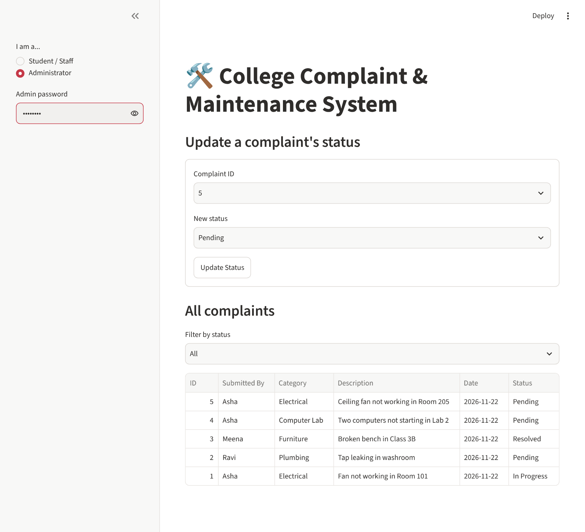

# Guide 1: Setting Up and Running the System on Your Computer

This guide is written like a story. Follow it from top to bottom and you will have the system running. No experience needed.

---

## 1. What are we building? (the big picture)

Imagine a **complaint box** at your college gate. Students drop a paper in: *"The fan in Room 101 is broken."* The office person opens the box, reads the papers, and writes on each one: *"Waiting"*, *"Someone is fixing it"* or *"Fixed!"*.

Our system is the **same complaint box, but on a computer**:

| Real world | Our computer system |
| --- | --- |
| The paper slip | One complaint (a row in the database) |
| The box that stores all the slips | The database (SQLite) |
| The window where you write the slip | The web page (Streamlit) |
| The person who thinks and decides | The Python code |

---

## 2. What do I need? (the toolbox)

| Tool | What it is, in simple words |
| --- | --- |
| **Python** | The language the program is written in. Like English, but for computers. |
| **Streamlit** | A helper that turns Python into a web page with buttons and boxes. |
| **SQLite** | A tiny notebook that lives in one file and remembers all complaints. It comes free with Python. |
| **Visual Studio Code (VS Code)** | A fancy notepad where we read and edit the code. |

You already have all of these installed. Let us double check.

### Check Python
1. Open VS Code.
2. Click **Terminal → New Terminal** at the top. A box appears at the bottom. This is the *terminal*: a place where you type commands to the computer.
3. Type this and press **Enter**:
   ```
   python --version
   ```
   You should see something like `Python 3.14.0`.
   (On Mac/Linux, if that fails, try `python3 --version`.)

### Check Streamlit
```
streamlit --version
```
You should see a version number. If you see *"command not found"*, install it:
```
pip install streamlit
```
(`pip` is Python's shop. This command says "go and fetch Streamlit for me".)

---

## 3. Get the project folder

The project lives in a folder called `College_Complaint_System`. Inside it you will see:

```
College_Complaint_System/
├── src/        <- the program itself
├── tests/      <- a checker that tests our program
├── data/       <- where the database file will appear
├── docs/       <- these guides
└── requirements.txt
```

**Think of it like a school bag:** `src` is your textbooks (the real stuff), `tests` is your exam paper, `data` is your notebook, `docs` is your teacher's notes.



If the project is on GitHub, download it with `git clone <the-project-link>`, or simply copy the folder to your computer.

---

## 4. Open the project in VS Code

1. In VS Code choose **File → Open Folder**.
2. Pick `College_Complaint_System`.
3. On the left you will see all the files.

Important: the terminal must be *inside* this folder. If it is not, type:
```
cd College_Complaint_System
```
(`cd` means "change directory", which means "walk into this folder". If the terminal line already ends with `College_Complaint_System`, you are already inside. Skip this.)

---

## 5. Start the system (the exciting part)

Type this in the terminal and press **Enter**:
```
streamlit run src/app.py
```

What happens:
1. Streamlit wakes up and reads `src/app.py`.
2. **Your web browser opens by itself** at an address like `http://localhost:8501`.
3. You see the title **"College Complaint & Maintenance System"**.

> **What is `localhost`?** It means "this very computer". The web page is not on the internet. It lives only on your machine, like a toy shop you built in your own room. Nobody else can see it.

The first time it runs, the program **automatically creates the database file** `data/complaints.db`. You do not have to create anything by hand.

### To stop the system
Click the terminal and press **Ctrl + C**. The page stops working until you start it again. Your complaints are still saved (see Guide 2).

---

## 6. Try it out (a 5-minute tour)

### As a Student/Staff
1. In the left sidebar, make sure **Student / Staff** is selected.



*This is the first screen you see. The left sidebar picks your role and holds your name box.*
2. In **"Your name or ID"** type `Asha`.
3. In the **Register Complaint** tab, choose a category (e.g. Electrical) and type: `Fan not working in Room 101`.


4. Click **Submit Complaint**. A green message shows your **Complaint ID** and that the status is **Pending**.


5. Click the **My Complaints** tab. Your complaint is listed.



> Use the **same name** next time. The name is how the system remembers which complaints are yours (like writing your name on your lunch box).

### As the Administrator
1. In the sidebar choose **Administrator**.


2. Type the password: `admin123`.
3. Under **Update a complaint's status**, pick the Complaint ID, choose **In Progress**, click **Update Status**.
4. Scroll down to **All complaints**. You can filter by status.



### Back as the Student
Switch to **Student / Staff**, type `Asha`, open **My Complaints**. The status now says **In Progress**.

You just watched the complete journey of a complaint.

---

## 7. Run the tests (proof that it works)

Tests are like a teacher checking your homework automatically. In the terminal:
```
python tests/test_database.py
```
You should see lines starting with `PASS` and at the end `11/11 tests passed`.

**Keep this output** (copy it or take a screenshot). It is your *testing evidence* for the report.

The tests use a **temporary** database, so they never touch your real complaints.

---

## 8. Starting again another day

1. Open VS Code → open the `College_Complaint_System` folder.
2. Open the terminal.
3. Run `streamlit run src/app.py`.

Old complaints are still there because they are stored in `data/complaints.db`.

---

## 9. Starting fresh (erasing all complaints)

1. Stop the system (Ctrl + C).
2. Delete the file `data/complaints.db`.
3. Start the system again. A new empty database is created.

> Real-world example: like throwing away the old notebook and buying a new empty one.

---

## 10. Things that can go wrong (and easy fixes)

| What you see | What it means | What to do |
| --- | --- | --- |
| `'streamlit' is not recognized` / `command not found` | Streamlit is not installed or not found | Run `pip install streamlit`. Or try `python -m streamlit run src/app.py` |
| `can't open file ... src/app.py` | The terminal is in the wrong folder | Use `cd` to go into `College_Complaint_System` |
| Browser did not open | Sometimes happens | Open a browser and visit `http://localhost:8501` |
| `Port 8501 is already in use` | The app is already running in another terminal | Close the other terminal, or run `streamlit run src/app.py --server.port 8502` |
| "Please describe the problem." red message | You left the description empty | Type something and submit again |
| "Enter your name or ID" blue message | The sidebar name is empty | Type your name in the sidebar |
| Admin page only says "Enter the admin password" | Wrong or missing password | The password is `admin123` |
| My Complaints is empty | You typed a different name than when you submitted | Use the same name (capital letters do not matter) |

---

## 11. Quick cheat sheet

| I want to... | I type... |
| --- | --- |
| Start the system | `streamlit run src/app.py` |
| Stop the system | `Ctrl + C` |
| Run the tests | `python tests/test_database.py` |
| Erase all complaints | Delete `data/complaints.db` |
| Open the system in the browser | `http://localhost:8501` |

Next: read **Guide 2 (Database)** to learn where the complaints are kept.
